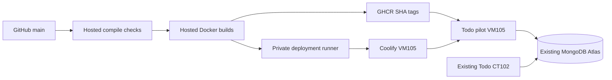

# ADR-0001: GitHub image builds and a private Coolify deployment runner

## Status

Accepted for the Todo pilot. Existing CT102 deployment remains the rollback.

## Context

Todo is a public GitHub repository deployed manually to CT102. Its MongoDB data lives in Atlas; its two containers have no persistent volumes. Proxmox has 20 GB RAM, but application storage and CPU capacity are limited. Coolify runs in VM105 on a private LAN address. We need reproducible releases without opening an Internet-facing deployment endpoint or building Node applications on the homelab.

## Decision

GitHub-hosted runners compile both components and publish Linux/amd64 images with full commit SHA tags to GHCR. Only after both image jobs succeed, a dedicated unprivileged GitHub Actions runner in VM105 updates the Coolify application's image selector and pinned Git commit, requests deployment, waits for its result, and checks Todo health. Deployments run only for main; PR jobs use hosted runners. The deployment runner has neither Docker socket membership nor sudo access. Its Coolify token has read/write/deploy permissions, without root or sensitive-read access, and is supplied by a repository secret only to the deployment job. Keep the Coolify team restricted to trusted administrators.

The pilot runs at `http://192.168.0.190:3000`. CT102's existing `http://192.168.0.226:3000` remains available. Both use the existing Atlas database and JWT key; this is a parallel production client, not an isolated staging database. No automated jobs create or delete production tasks or users. The client origin changes only for the new instance. Preserve existing GlitchTip settings.

## Consequences

Builds do not consume homelab CPU or memory, and failed compilation or image publication cannot advance the deployment. Deployment jobs serialize, skip superseded main revisions, and fail on unsuccessful Coolify rollout or health checks. A failed deployment is reported; rollback remains an explicit operator action. Previous SHA-tagged images can be selected for rollback.

The local runner adds maintenance and security responsibility. Never schedule untrusted fork code on it, approve external contributor workflows only after reviewing all workflow changes, and retain the main-only deployment guard. A public repository runner must be treated as a privileged deployment component even without Docker access. Restrict repository collaborators, keep runner software current, and rotate the Coolify token before expiration. No production secrets enter Docker build contexts, image build arguments, or logs; the frontend GlitchTip DSN is intentionally public.

The pilot does not automatically cut over proxy routes, migrate databases, or remove CT102's images. A successful health endpoint confirms process reachability; authenticated user flows still need owner validation. The shared Atlas database prevents calling this an isolated staging environment.

## Alternatives

- Build in Coolify: simpler, but consumes shared homelab resources.
- GitHub webhook to Coolify: requires a publicly reachable authenticated deployment endpoint or VPN setup.
- GitHub-hosted deployment over Tailscale: appropriate later, but requires a separately provisioned GitHub OAuth/auth-key integration.
- Jenkins or GitLab: more services and maintenance while GitHub already hosts the source and build infrastructure.

## References

- https://coolify.io/docs/core/build-deployment-model
- https://coolify.io/docs/api/permissions
- https://docs.github.com/en/actions/security-for-github-actions/security-guides/security-hardening-for-github-actions
